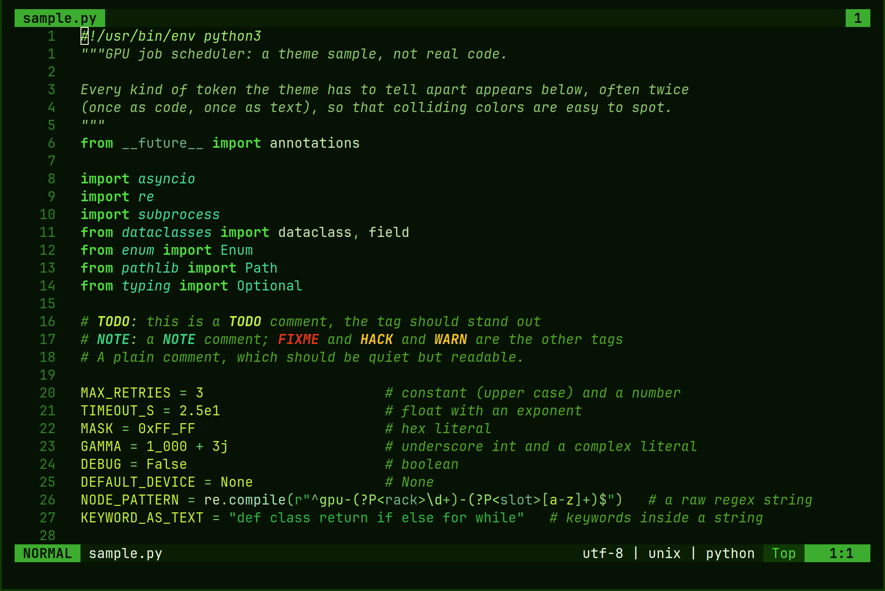
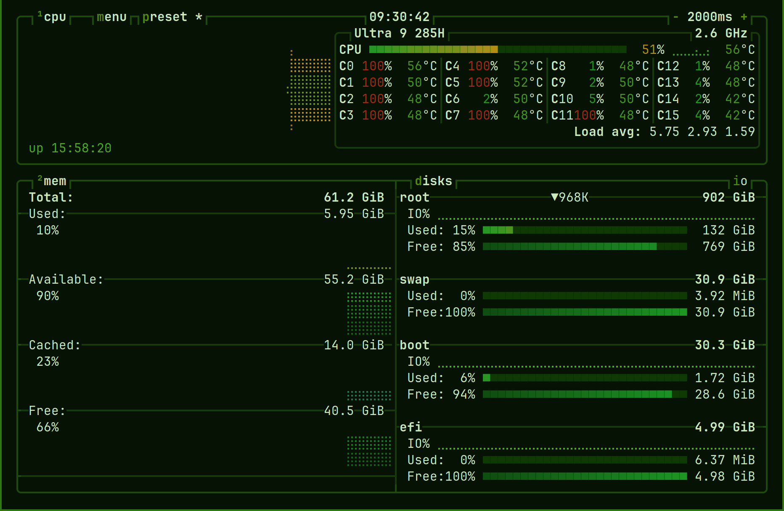
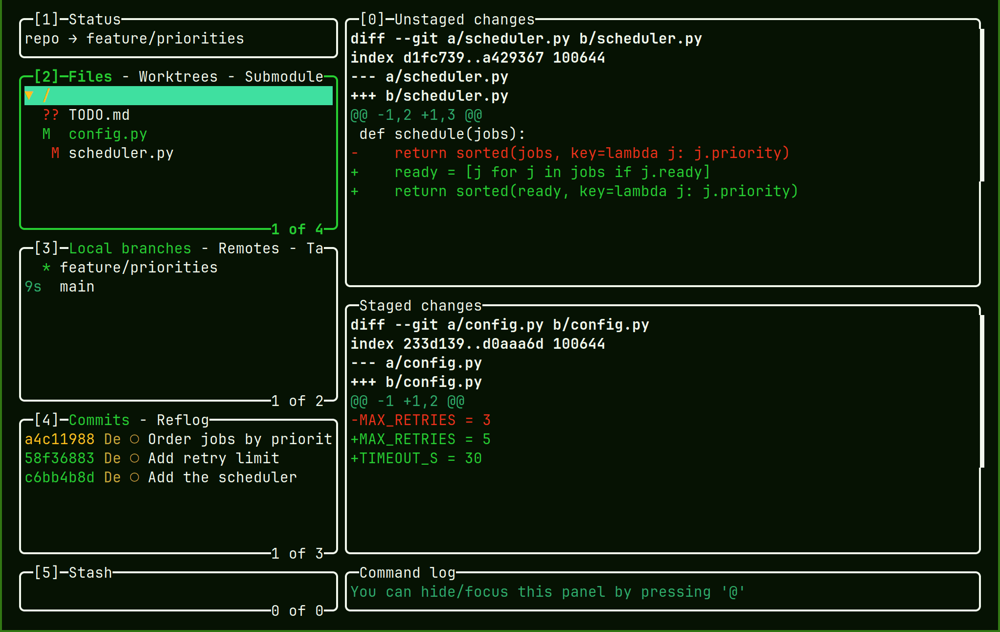

# Malachite

A green colorscheme for terminals, editors and desktops. Colors are named for what they are for, so
every app gets the same meanings: strings, keywords and warnings look alike in your editor, your
terminal, your status bar and your notifications. **Emerald** is the saturated flavor and the
default. **Jade** is a restrained, olive variant that is still being polished.

<table>
  <tr>
    <td></td>
    <td></td>
  </tr>
  <tr>
    <td align="center">Neovim</td>
    <td align="center">btop: load runs green, amber, scarlet</td>
  </tr>
  <tr>
    <td colspan="2" align="center"></td>
  </tr>
  <tr>
    <td colspan="2" align="center">lazygit: no configuration, it takes the terminal's colors</td>
  </tr>
</table>

Both flavors are dark. Nearly every color is a green; amber is the warning and a red is the error.

| Role | Emerald | Jade |
|---|---|---|
| bg | `#061203` | `#050901` |
| surface | `#103a04` | `#20360c` |
| fg | `#f2f8ed` | `#eef0ea` |
| accent | `#76b900` | `#76b900` |
| success | `#27ce32` | `#76b900` |
| warning | `#ffc21a` | `#ffbc3d` |
| error | `#ed311c` | `#ed1c31` |
| string | `#2bb642` | `#4db342` |
| keyword | `#4fe03d` | `#62d043` |

## Install

Pick the way that fits your machine, then apply the colors to your apps (next section).

**Arch Linux.** Build the package from a release tarball:

```sh
cd packaging/arch      # with malachite-colorscheme-<version>.tar.gz beside the PKGBUILD
makepkg -si
```

**Debian and Ubuntu.** Install the `.deb` from a release:

```sh
sudo apt install ./malachite-colorscheme_<version>_all.deb
```

**Nix and home-manager.** See Home-manager below: one option turns it all on.

**By hand.** Every app's file is in the release tarball (`usr/share/malachite/<flavor>/<app>/`), each
with an `INSTALL.md` that says where it goes.

The packages install under `/usr/share`, which is also where foot, btop and Neovim already look for
themes, so those three need no copying.

## Apply it to your apps

A package or tarball gives you `/usr/share/malachite/<flavor>/<app>/`, holding the file and an
`INSTALL.md` for that app. What to do with each, in one line:

| App | What to do |
|---|---|
| foot | add `include=/usr/share/foot/themes/malachite-emerald` to `~/.config/foot/foot.ini` |
| btop | choose the theme `malachite-emerald` in Options, or `color_theme = "malachite-emerald"` in `btop.conf` |
| tmux | `source-file /usr/share/malachite/emerald/tmux/malachite-emerald.conf` in `tmux.conf` |
| Neovim | install the [tinted-nvim](https://github.com/tinted-theming/tinted-nvim) plugin, then `:colorscheme malachite-emerald` |
| lualine | `require("lualine").setup({ options = { theme = "malachite-emerald" } })` |
| sway | `include /usr/share/malachite/emerald/sway/malachite-emerald.conf` in the sway config |
| waybar, gtklock | `@import "malachite-emerald.css";` at the top of your stylesheet |
| mako, swaynag | copy the lines from the file into your config (neither has an include) |
| fzf | `export FZF_DEFAULT_OPTS_FILE=/usr/share/malachite/emerald/fzf/malachite-emerald.fzf` |
| Claude Code | copy the `.json` to `~/.claude/themes/`, then `/theme` |
| htop | `cat /usr/share/malachite/emerald/htop/malachite-emerald.osc; htop`, in the terminal you will use |
| any terminal | `cat /usr/share/malachite/emerald/terminal/malachite-emerald.osc` sets the 16 colors |

Use `jade` in place of `emerald` for the other flavor. The two `.osc` files are escape sequences,
not config: they recolor the terminal that prints them, over ssh as well, until it closes. Each
app's `INSTALL.md` has the details and what you should see.

## Home-manager

```nix
{
  imports = [ malachite.homeModules.default ];   # or import modules/home-manager.nix from a checkout
  malachite = {
    enable = true;
    flavor = "emerald";   # or "jade"
  };
}
```

With `malachite.enable`, each port is applied to the program you have enabled: foot, btop, tmux, fzf,
Claude Code, sway, mako, waybar and Neovim (with its lualine theme). Turn one off with
`malachite.ports.<app>.enable = false`. The module needs no flake: it imports its sibling files by
path.

Other modules receive the colorscheme as the `colorscheme` argument (the roles are
`colorscheme.roles`) and the library as `malachite`. The path of a port's file for the selected
flavor is `malachite.portFile "<port>" "<extension>"`. swaynag and gtklock need your own config, so
a module reads their port's text instead: `(malachite.lib.ports.swaynag colorscheme).text`.

## From a clone

```sh
nix eval --json .#colorschemes.emerald     # the colorscheme as JSON
nix build .#default                        # result/share/malachite/<flavor>/<app>/, both flavors
nix build .#release                        # the tarball the distro packages install
nix build .#deb                            # the Debian package
```

A colorscheme is plain data: 16 Base16 `slots`, 28 named `roles` (see CONTRIBUTING.md) and 16 `ansi`
colors, all `#rrggbb`. The library builds one from Base16 slots and converts to and from Base16 files:

```nix
malachite.lib.mkColorscheme { slots = { base00 = "#..."; /* ... */ }; overrides = { }; }
malachite.lib.fromBase16Yaml (builtins.readFile ./scheme.yaml)
malachite.lib.toBase16Yaml malachite.colorschemes.emerald
malachite.lib.ports.fzf malachite.colorschemes.emerald   # one port: { file, text, install, ... }
malachite.lib.mix "#000000" "#ffffff" 0.5                # a blend from the first color to the second
```

Another colorscheme can use every port: build it with `mkColorscheme` and pass it to the module as
`malachite.colorscheme`.

## Stability

Semantic versioning. Stable: the role names (new roles may be added with derived defaults),
`colorscheme.json` `format = 1`, the file names and paths ports install to, and these library
functions: `mkColorscheme`, `fromBase16Yaml`, `toBase16Yaml`, `parseBase16`, `toSlots`, `hex`, `css`,
`mix`, `ramp` and `ports`.

Status: version 0.1, not yet released. The library, both flavors, the conformance checks, fourteen
ports, a home-manager module and the distro packages work; 1.0 follows real use.

## License

MIT.
